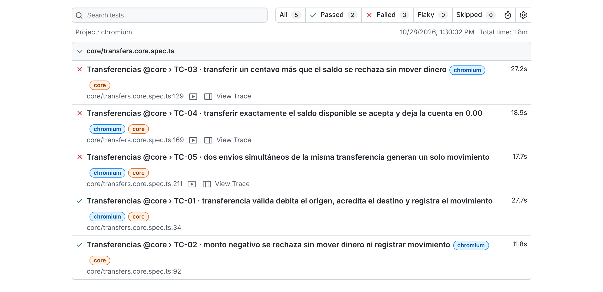

# BuggyBank · Suite de pruebas con Playwright

Mi entrega del **Desafío BuggyBank** de Free Range Testers: pruebas automatizadas contra [BuggyBank](https://buggybank-seven.vercel.app/login), un banco de práctica con bugs sembrados a propósito.

| | |
|---|---|
| **Flujo elegido** | Transferencias: 5 pruebas `@core` |
| **Herramienta** | Playwright + TypeScript |
| **Resultado** | 2 en verde y 3 en rojo, los tres por bugs reales de la app |
| **Hallazgo propio** | BUG-24: las transferencias de importe entero ≥ 500 se aplican dos veces |
| **Bugs documentados** | 24, en [`docs/BUGS.md`](docs/BUGS.md) |
| **Plan de pruebas** | [`docs/TEST_PLAN.md`](docs/TEST_PLAN.md) |
| **Las 5 pruebas, explicadas** | [`docs/CASOS_CORE.md`](docs/CASOS_CORE.md), paso a paso y sin saber programar |

---

## Resultado de la entrega

Ejecución del 28/10/2026 con sandboxes nuevos (`npm run test:core`):

| ID | Qué debería pasar | Riesgo que cubre | Resultado |
|----|-------------------|------------------|-----------|
| **TC-01** Transferencia válida (13.37) | Se debita el origen, se acredita el destino y queda un movimiento | Dinero que se pierde o se crea | ✅ Verde |
| **TC-02** Importe negativo (-50) | Se rechaza sin efectos | Transferencia "al revés" | ✅ Verde: la interfaz lo bloquea (la API no, ver BUG-04) |
| **TC-03** Fondos insuficientes (saldo + 0.01) | Se rechaza sin efectos | Descubierto | ❌ **Rojo → BUG-01** |
| **TC-04** Saldo exacto | Se acepta y la cuenta queda en 0.00 | Límite mal programado (`>` frente a `>=`) | ❌ **Rojo → BUG-24** |
| **TC-05** Doble envío simultáneo | Una sola transferencia | Cobro duplicado | ❌ **Rojo → BUG-02** |

**Los rojos son intencionados.** El desafío pide no cambiar el resultado esperado para conseguir un verde: las cinco pruebas comprueban lo correcto y la que falla es la app. Cada rojo lleva una anotación con su bug, visible en el informe HTML.

### El hallazgo: BUG-24

TC-04 tenía que salir en verde: en la exploración del 17/10 transferir el saldo exacto funcionaba. Al ejecutarla, salió en rojo, y la traza de Playwright mostró por qué:

1. Saldo antes: CHECKING 6,500 y SAVINGS 3,500.
2. Sale **una sola petición** `POST /api/transfers` con `amount: 6500`, y el servidor responde `{"message":"OK transfer","duplicated":true}`.
3. Saldo después: CHECKING **-6,500** y SAVINGS 16,500. Se ha movido **el doble**.
4. En el historial aparece un **segundo movimiento** con la nota `… (duplicate)`. Mi primera lectura fue que había uno solo: la prueba buscaba la nota exacta y no veía el duplicado (ya la he corregido).

**El disparador no era el saldo exacto.** Lo localicé a mano con análisis de valores límite, transfiriendo importes distintos con una nota para cada uno:

| Importe | ¿Se duplica? |
|---|---|
| 100 · 101 · 300 · **499** | No |
| **500** · 999 · 1.000 · 3.000 · 6.500 · 13.000 · 19.500 | **Sí** |
| 2,22 · 13,37 · 99,99 · 3.500,50 · 6.500,01 | No |

> **Una transferencia de importe entero de 500 o más se aplica dos veces.** Con decimales no ocurre. TC-04 lo destapó porque el saldo exacto (6.500) cumple esa condición. Solo he probado esos importes; no sé si hay más disparadores.

## Cómo están diseñadas las pruebas

**Saldos relativos y nota única.** Ninguna prueba compara contra un saldo fijo. Cada una toma una "foto" de los saldos por API al empezar, hace la acción por la interfaz y compara la diferencia **en céntimos enteros**, para evitar errores de coma flotante como `0.1 + 0.2 = 0.30000000000000004`. Cada operación lleva una nota única (`QA-TC01-<id>`) para encontrar exactamente ese movimiento. Así la suite funciona con cualquier sandbox y en cualquier orden.

Otras decisiones:

- **Doble comprobación, interfaz y API.** El mensaje "OK transfer" es la comprobación más débil; los saldos y el movimiento se verifican contra la API.
- **`expect.soft`** en las comprobaciones de negocio: si falla el débito, se siguen evaluando el crédito, el total y el movimiento, y el informe lo muestra todo.
- **TC-01 no comprueba `direction`**, porque está roto en todas las transferencias (BUG-09). Si lo comprobara, un bug de Movimientos taparía el resultado real de la transferencia.
- **Un solo worker:** todas las pruebas usan las mismas dos cuentas; en paralelo se pisarían los saldos.
- **Limpieza que se comprueba:** al terminar, cada prueba devuelve CHECKING a su saldo inicial y **verifica** que lo ha conseguido. Si no, el informe muestra un aviso para crear un sandbox nuevo.
- **Esperas explícitas:** las 5 pruebas de la entrega no usan esperas fijas (`waitForTimeout`). En la suite extendida quedan tres márgenes de 2 s (TR-12, TR-16 y PG-06) para comprobar que algo *no* ocurre; están anotados en [`docs/EXTENDED_RESULTS.md`](docs/EXTENDED_RESULTS.md).

## Requisitos e instalación

- **Node.js 18 o superior** (`node --version`). Si no lo tienes, instálalo desde <https://nodejs.org>.
- Un **sandbox de BuggyBank** activo (dura 24 horas, ver más abajo).

Solo la primera vez. Pega este bloque entero en la terminal. Comprueba si el proyecto ya existe antes de clonarlo, para no tener dos copias:

```bash
if [ -f package.json ] && grep -q '"name": "buggybank-playwright"' package.json; then
  echo "Ya estás dentro del proyecto: no lo clono otra vez."
elif [ -d buggybank-playwright ]; then
  cd buggybank-playwright
  echo "El proyecto ya existe aquí: entro en su carpeta, no lo clono otra vez."
else
  git clone https://github.com/BasiMontes/buggybank-playwright.git
  cd buggybank-playwright
  echo "Proyecto clonado."
fi
npm install
npm run install:browsers
```

> ⚠️ Si ya tienes la carpeta del proyecto, **no la clones dentro de sí misma**. Trabaja siempre en la carpeta que contiene `package.json` y el `.env`. Si ves una carpeta `buggybank-playwright` dentro de otra `buggybank-playwright`, borra la interior después de copiar su `.env` si lo necesitas.

## Preparar el sandbox (cada 24 horas)

Un sandbox es un usuario temporal de BuggyBank con dos cuentas (CHECKING y SAVINGS) y saldos de práctica. Caduca a las 24 horas, así que hay que crear uno nuevo cada día que vayas a ejecutar las pruebas.

1. Entra en <https://buggybank-seven.vercel.app/login>.
2. Escribe el **código del curso** en el campo *Código del curso* y pulsa **Crear usuario temporal**.
3. La app te muestra un **email** y una **contraseña**. Cópialos.
4. En la terminal, **dentro de la carpeta del proyecto** (la que contiene `package.json`), comprueba si ya existe el archivo `.env`:

   ```bash
   ls -la .env
   ```

   - **Si sale una línea con `.env`**, el archivo ya existe. **No lo crees otra vez**: ve directamente al paso 5 y sustituye los valores.
   - **Si sale `No such file or directory`**, créalo copiando la plantilla:

     ```bash
     cp .env.example .env
     ```

     > ⚠️ `cp` sobrescribe el `.env` sin preguntar. No lo ejecutes si ya tienes un `.env` con credenciales.

5. Abre el `.env` para pegar el **email** y la **contraseña** del sandbox que acabas de crear:

   ```bash
   open -e .env
   ```

   Se abre en TextEdit. Pega los valores en `BB_EMAIL=` y `BB_PASSWORD=`, sin espacios ni comillas. **No cambies `BB_BASE_URL`**. Guarda con `Cmd + S`.

6. Comprueba que la contraseña ha quedado guardada. Debe salir `1`:

   ```bash
   grep -c '^BB_PASSWORD=.' .env
   ```

> ⚠️ El `.env` está en `.gitignore` y **nunca se sube** al repositorio. Cuando el sandbox caduque, crea otro y actualiza solo esos dos valores.

## Cómo ejecutar la entrega (`@core`), paso a paso

Estos son los pasos para las 5 pruebas de la entrega. Hazlo siempre con un sandbox recién creado.

1. **Abre la terminal** y ve a la carpeta del proyecto (la que contiene `package.json`):
   ```bash
   cd ruta/a/buggybank-playwright
   ```
2. **Comprueba que el `.env` tiene tu sandbox de hoy.** Debe salir `1`:
   ```bash
   grep -c '^BB_PASSWORD=.' .env
   ```
3. **Ejecuta las pruebas** (tardan unos 1,5 minutos):
   ```bash
   npm run test:core
   ```
   Resultado esperado: **2 en verde** (TC-01 y TC-02) y **3 en rojo** (TC-03, TC-04 y TC-05). Los rojos son bugs de la app, no errores de la prueba; cada uno lleva su anotación con el bug.
4. **Abre el informe:**
   ```bash
   npm run report
   ```
   La terminal muestra una dirección tipo `http://localhost:9323`. Ábrela en el navegador.
   El comando **no termina**: se queda activo para servir el informe. Para cerrarlo, pulsa `Ctrl + C` en la terminal.

**Si algo sale mal:**

| Lo que ves | Qué hacer |
|---|---|
| `falta BB_EMAIL, revisa tu .env` | El `.env` no está completo. Revisa los dos valores. |
| Errores de login o `401` | El sandbox ha caducado o está mal copiado. Crea uno nuevo y actualiza el `.env`. |
| Aviso "La limpieza no dejó el saldo como estaba" en el informe | El sandbox ha quedado descuadrado. Crea uno nuevo antes de volver a ejecutar. |
| `Executable doesn't exist` o falta Chromium | Ejecuta `npm run install:browsers` y repite. |
| `localhost:9323` no carga | Hay otro informe abierto. Pulsa `Ctrl + C` en la terminal y vuelve a ejecutar `npm run report`. |

Para entender cada prueba paso a paso, lee [`docs/CASOS_CORE.md`](docs/CASOS_CORE.md).

## Ejecutar

| Comando | Qué ejecuta |
|---|---|
| `npm run install:browsers` | Descarga Chromium (solo la primera vez) |
| `npm run test:core` | **La entrega:** las 5 pruebas `@core` de Transferencias |
| `npm run test:headed` | Las mismas 5, con el navegador visible |
| `npm run test:extended` | La suite extendida por interfaz (`@extended`): no es la entrega, ver [`docs/EXTENDED_RESULTS.md`](docs/EXTENDED_RESULTS.md) |
| `npm run test:api` | Las pruebas directas de API (`@api`): no es la entrega |
| `npm run test:sin-core` | Las 65 pruebas que **no** son la entrega (todo menos `@core`). Es el comando para repetir la clasificación de `docs/EXTENDED_RESULTS.md` |
| `npm test` | Todo junto: las 70 pruebas (5 de la entrega y 65 de extendida y API) |
| `npm run test:ui` | El modo interactivo de Playwright |
| `npm run report` | Abre el informe HTML de la última ejecución |
| `npm run typecheck` | Comprueba los tipos sin ejecutar nada |

> ⚠️ La suite extendida y la de API no están pensadas para ejecutarse sobre el mismo sandbox que la entrega: BUG-24 duplica transferencias y puede dejar los saldos descuadrados. Crea un sandbox nuevo antes de cada ejecución.

Una prueba concreta: `npx playwright test -g "TC-04"`.

## Evidencia

`npm run report` abre el informe HTML. Para cada prueba fallida hay **captura**, **vídeo**, **traza** (DOM, red y consola paso a paso), **adjuntos JSON** con los saldos antes y después y las respuestas de la API, y una **anotación** con el bug.



_Captura del informe tomada con el propio Playwright._

## Uso de IA

He trabajado con Claude (Anthropic). Esto es lo que hizo cada parte:

| Etapa | Qué hizo la IA | Qué hice yo |
|---|---|---|
| **Exploración (17/10)** | Recorrió la app en un navegador con mi sesión iniciada, registró endpoints, `data-testid` y respuestas de la API, y ejecutó las operaciones que le autoricé. | Inicié sesión yo (la IA nunca escribió mi contraseña) y autoricé cada tipo de operación. |
| **Diseño** | Propuso el plan de casos, los riesgos y las decisiones principales (saldos relativos, nota única, doble comprobación). | Elegí el flujo y la herramienta, y cambié el segundo caso límite a doble envío. |
| **Código** | Escribió la suite completa, comentada. | La ejecuté por primera vez el 28/10 y revisé cada fallo en las trazas. |
| **Revisión (28/10)** | Me ayudó a leer las trazas y a proponer cambios. | Decidí qué cambiar y qué no (abajo). |

**Lo que cambié tras ejecutarla:**

- **TC-04 no se tocó para que saliera en verde.** El rojo era un bug nuevo de la app (BUG-24), así que le añadí la anotación y lo documenté.
- **La limpieza no comprobaba nada.** En TC-04, la transferencia que devuelve el dinero también se duplicó y dejó el sandbox descuadrado sin avisar. Ahora la limpieza verifica el saldo y, si no cuadra, lo dice en el informe.
- **TC-05 tenía una espera fija de 2 segundos.** La traza mostró que las dos peticiones salen a la vez, pero responden a los 1,8 s y a los 4,4 s: la espera acertaba por poco. La cambié por una espera explícita hasta que todas las peticiones tienen respuesta.
- **La IA concluyó que el disparador era el saldo exacto, y estaba equivocada.** Mi exploración manual lo desmintió (6.500 con un saldo de 45.500 también se duplica) y localizó el límite real en 500.

**Lo que descarté:** el informe de Playwright tiene un botón "Copy prompt" que pide a una IA "un fragmento de código con la solución" de un test fallido. En TC-04, esa "solución" habría sido cambiar lo esperado para que la prueba pasara y esconder el bug. Cuando una prueba falla, primero decido si el fallo es del test o del producto.

## Pendiente

- **La suite extendida y de API (65 pruebas) la generó la IA y la he ejecutado y clasificado.** En la ejecución completa del 28/10 (70 pruebas) salieron 44 en verde y 26 en rojo. Los rojos están explicados en [`docs/EXTENDED_RESULTS.md`](docs/EXTENDED_RESULTS.md): bugs de la app, dos preguntas abiertas y cinco fallos de mis propias pruebas, ya corregidos. Las 44 verdes se revisaron una a una; seis de ellas solo comprueban la pantalla y no el backend (PG-02, PG-03, TR-06, TR-10, TR-11 y PF-02), y así está anotado.
- Ejecutar la suite en GitHub Actions con las credenciales como *secrets* (hoy no es práctico: el sandbox caduca cada 24 horas).

## Para comentar en la charla

- **Bug:** BUG-24. Una sola petición mueve el doble si el importe es entero y ≥ 500; lo acoté con valores límite (499 no, 500 sí).
- **Decisión:** las esperas explícitas. La traza demostró que la espera fija de TC-05 era frágil.
- **Pregunta:** en la traza, la cookie de sesión se llama `bb_user` y su valor parece ser el identificador del usuario. Si el servidor no comprueba nada más, ¿se podría suplantar a otro usuario? No lo he probado para no afectar a los sandboxes de otras personas.
