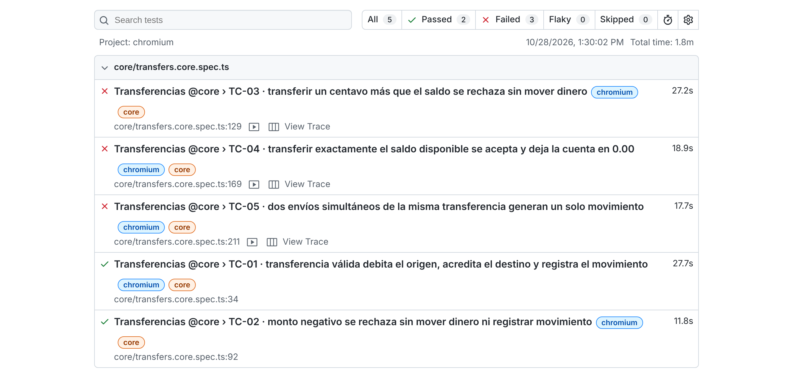

# BuggyBank · Suite de pruebas con Playwright

Mi entrega del **Desafío BuggyBank** de Free Range Testers: pruebas automatizadas contra [BuggyBank](https://buggybank-seven.vercel.app/login), un banco de práctica con bugs sembrados a propósito.

| | |
|---|---|
| **Flujo elegido** | Transferencias: 5 pruebas `@core` |
| **Herramienta** | Playwright + TypeScript |
| **Resultado** | 2 en verde y 3 en rojo, los tres por bugs reales de la app |
| **Hallazgo propio** | BUG-24: las transferencias de importe entero ≥ 500 se aplican dos veces |
| **Bugs documentados** | 24, en [`docs/BUGS.md`](docs/BUGS.md) |
| **Plan de pruebas** | [`docs/TEST_PLAN.md`](docs/TEST_PLAN.md) |

---

## Resultado de la entrega

Ejecución del 28/10/2026 con sandboxes nuevos (`npm run test:core`):

| ID | Qué debería pasar | Riesgo que cubre | Resultado |
|----|-------------------|------------------|-----------|
| **TC-01** Transferencia válida (13.37) | Se debita el origen, se acredita el destino y queda un movimiento | Dinero que se pierde o se crea | ✅ Verde |
| **TC-02** Importe negativo (-50) | Se rechaza sin efectos | Transferencia "al revés" | ✅ Verde: la interfaz lo bloquea (la API no, ver BUG-04) |
| **TC-03** Fondos insuficientes (saldo + 0.01) | Se rechaza sin efectos | Descubierto | ❌ **Rojo → BUG-01** |
| **TC-04** Saldo exacto | Se acepta y la cuenta queda en 0.00 | Límite mal programado (`>` frente a `>=`) | ❌ **Rojo → BUG-24** |
| **TC-05** Doble envío simultáneo | Una sola transferencia | Cobro duplicado | ❌ **Rojo → BUG-02** |

**Los rojos son intencionados.** El desafío pide no cambiar el resultado esperado para conseguir un verde: las cinco pruebas comprueban lo correcto y la que falla es la app. Cada rojo lleva una anotación con su bug, visible en el informe HTML.

### El hallazgo: BUG-24

TC-04 tenía que salir en verde: en la exploración del 17/10 transferir el saldo exacto funcionaba. Al ejecutarla, salió en rojo, y la traza de Playwright mostró por qué:

1. Saldo antes: CHECKING 6,500 y SAVINGS 3,500.
2. Sale **una sola petición** `POST /api/transfers` con `amount: 6500`, y el servidor responde `{"message":"OK transfer","duplicated":true}`.
3. Saldo después: CHECKING **-6,500** y SAVINGS 16,500. Se ha movido **el doble**.
4. En el historial aparece un **segundo movimiento** con la nota `… (duplicate)`. Mi primera lectura fue que había uno solo: la prueba buscaba la nota exacta y no veía el duplicado (ya la he corregido).

**El disparador no era el saldo exacto.** Lo localicé a mano con análisis de valores límite, transfiriendo importes distintos con una nota para cada uno:

| Importe | ¿Se duplica? |
|---|---|
| 100 · 101 · 300 · **499** | No |
| **500** · 999 · 1.000 · 3.000 · 6.500 · 13.000 · 19.500 | **Sí** |
| 2,22 · 13,37 · 99,99 · 3.500,50 · 6.500,01 | No |

> **Una transferencia de importe entero de 500 o más se aplica dos veces.** Con decimales no ocurre. TC-04 lo destapó porque el saldo exacto (6.500) cumple esa condición. Solo he probado esos importes; no sé si hay más disparadores.

## Cómo están diseñadas las pruebas

**Saldos relativos y nota única.** Ninguna prueba compara contra un saldo fijo. Cada una toma una "foto" de los saldos por API al empezar, hace la acción por la interfaz y compara la diferencia **en céntimos enteros**, para evitar errores de coma flotante como `0.1 + 0.2 = 0.30000000000000004`. Cada operación lleva una nota única (`QA-TC01-<id>`) para encontrar exactamente ese movimiento. Así la suite funciona con cualquier sandbox y en cualquier orden.

Otras decisiones:

- **Doble comprobación, interfaz y API.** El mensaje "OK transfer" es la comprobación más débil; los saldos y el movimiento se verifican contra la API.
- **`expect.soft`** en las comprobaciones de negocio: si falla el débito, se siguen evaluando el crédito, el total y el movimiento, y el informe lo muestra todo.
- **TC-01 no comprueba `direction`**, porque está roto en todas las transferencias (BUG-09). Si lo comprobara, un bug de Movimientos taparía el resultado real de la transferencia.
- **Un solo worker:** todas las pruebas usan las mismas dos cuentas; en paralelo se pisarían los saldos.
- **Limpieza que se comprueba:** al terminar, cada prueba devuelve CHECKING a su saldo inicial y **verifica** que lo ha conseguido. Si no, el informe muestra un aviso para crear un sandbox nuevo.
- **Esperas explícitas:** las 5 pruebas de la entrega no usan esperas fijas (`waitForTimeout`). Las tres que quedan en la suite sin revisar (TR-12, TR-16 y PG-06) son márgenes para comprobar que algo *no* ocurre; están en la lista de revisión.

## Requisitos e instalación

- **Node.js 18 o superior** (`node --version`).
- Un **sandbox de BuggyBank** activo (dura 24 horas).

```bash
git clone https://github.com/BasiMontes/buggybank-playwright.git
cd buggybank-playwright
npm install
npm run install:browsers
```

## Preparar el sandbox (cada 24 horas)

1. Entra en <https://buggybank-seven.vercel.app/login>.
2. Escribe el **código del curso** y pulsa **Crear usuario temporal**.
3. Crea el archivo de credenciales y rellena el email y la contraseña que te da la app:

   ```bash
   cp .env.example .env
   ```

> ⚠️ El `.env` está en `.gitignore` y **nunca se sube**. Cuando el sandbox caduque, crea otro y actualiza esos dos valores.

## Ejecutar

| Comando | Qué ejecuta |
|---|---|
| `npm run install:browsers` | Descarga Chromium (solo la primera vez) |
| `npm run test:core` | **La entrega:** las 5 pruebas `@core` de Transferencias |
| `npm run test:headed` | Las mismas 5, con el navegador visible |
| `npm run test:extended` | La suite extendida por interfaz (`@extended`), sin revisar |
| `npm run test:api` | Las pruebas directas de API (`@api`), sin revisar |
| `npm test` | Todo junto: las 5 de la entrega y las 61 sin revisar (66) |
| `npm run test:ui` | El modo interactivo de Playwright |
| `npm run report` | Abre el informe HTML de la última ejecución |
| `npm run typecheck` | Comprueba los tipos sin ejecutar nada |

> ⚠️ La suite extendida y la de API no están pensadas para ejecutarse sobre el mismo sandbox que la entrega: BUG-24 duplica transferencias y puede dejar los saldos descuadrados. Crea un sandbox nuevo antes de cada ejecución.

Una prueba concreta: `npx playwright test -g "TC-04"`.

## Evidencia

`npm run report` abre el informe HTML. Para cada prueba fallida hay **captura**, **vídeo**, **traza** (DOM, red y consola paso a paso), **adjuntos JSON** con los saldos antes y después y las respuestas de la API, y una **anotación** con el bug.



_Captura del informe tomada con el propio Playwright._

## Uso de IA

He trabajado con Claude (Anthropic). Esto es lo que hizo cada parte:

| Etapa | Qué hizo la IA | Qué hice yo |
|---|---|---|
| **Exploración (17/10)** | Recorrió la app en un navegador con mi sesión iniciada, registró endpoints, `data-testid` y respuestas de la API, y ejecutó las operaciones que le autoricé. | Inicié sesión yo (la IA nunca escribió mi contraseña) y autoricé cada tipo de operación. |
| **Diseño** | Propuso el plan de casos, los riesgos y las decisiones principales (saldos relativos, nota única, doble comprobación). | Elegí el flujo y la herramienta, y cambié el segundo caso límite a doble envío. |
| **Código** | Escribió la suite completa, comentada. | La ejecuté por primera vez el 28/10 y revisé cada fallo en las trazas. |
| **Revisión (28/10)** | Me ayudó a leer las trazas y a proponer cambios. | Decidí qué cambiar y qué no (abajo). |

**Lo que cambié tras ejecutarla:**

- **TC-04 no se tocó para que saliera en verde.** El rojo era un bug nuevo de la app (BUG-24), así que le añadí la anotación y lo documenté.
- **La limpieza no comprobaba nada.** En TC-04, la transferencia que devuelve el dinero también se duplicó y dejó el sandbox descuadrado sin avisar. Ahora la limpieza verifica el saldo y, si no cuadra, lo dice en el informe.
- **TC-05 tenía una espera fija de 2 segundos.** La traza mostró que las dos peticiones salen a la vez, pero responden a los 1,8 s y a los 4,4 s: la espera acertaba por poco. La cambié por una espera explícita hasta que todas las peticiones tienen respuesta.
- **La IA concluyó que el disparador era el saldo exacto, y estaba equivocada.** Mi exploración manual lo desmintió (6.500 con un saldo de 45.500 también se duplica) y localizó el límite real en 500.

**Lo que descarté:** el informe de Playwright tiene un botón "Copy prompt" que pide a una IA "un fragmento de código con la solución" de un test fallido. En TC-04, esa "solución" habría sido cambiar lo esperado para que la prueba pasara y esconder el bug. Cuando una prueba falla, primero decido si el fallo es del test o del producto.

## Pendiente

- **La suite extendida (`tests/extended`, `tests/api`, 61 pruebas) no está revisada.** La generó la IA en la exploración y aún no la he ejecutado ni repasado; la entrega son solo las 5 pruebas `@core`.
- Ejecutar la suite en GitHub Actions con las credenciales como *secrets* (hoy no es práctico: el sandbox caduca cada 24 horas).

## Para comentar en la charla

- **Bug:** BUG-24. Una sola petición mueve el doble si el importe es entero y ≥ 500; lo acoté con valores límite (499 no, 500 sí).
- **Decisión:** las esperas explícitas. La traza demostró que la espera fija de TC-05 era frágil.
- **Pregunta:** en la traza, la cookie de sesión se llama `bb_user` y su valor parece ser el identificador del usuario. Si el servidor no comprueba nada más, ¿se podría suplantar a otro usuario? No lo he probado para no afectar a los sandboxes de otras personas.
